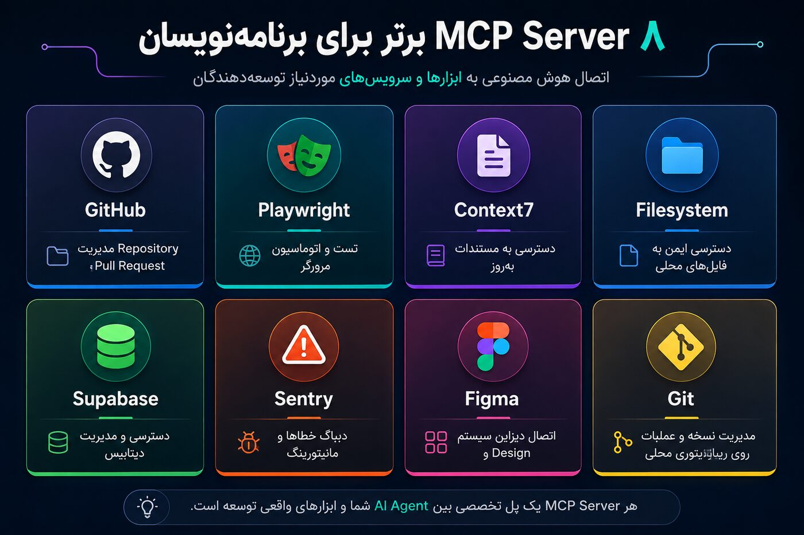

> [برگشت به فهرست](README.md) · قبلی: [۰۸ — مهندسی پرامپت](08-prompt-engineering.md) · بعدی: [۱۰ — Hooks و Commands](10-hooks-and-commands.md)

# فصل ۰۹ — ۶ MCP و Agent ضروری



> تصویر بالا نمای کلی اکوسیستم است. این فصل شش موردِ نشان‌داده‌شده را با جزئیات باز می‌کند و **Serena** (ناوبری معنایی کد) را هم اضافه می‌کند؛ Supabase و Figma در جدول «گزینه‌های افتخاری» انتهای بخش الف آمده‌اند.

## بخش الف — شش سرور MCP

> **چطور این بخش را بخوانید.** هر مدخل به چهار پرسش یکسان پاسخ می‌دهد: *چیست* و کجای Claude Code می‌نشیند، *چطور کار می‌کند*، *برای چه کاری*، و *چطور وصلش کنیم*. اگر ابزار را می‌شناسید، فقط تیترها را مرور کنید.

---

### ۱. Context7 — مستندات به‌روز

**چیست.** یک سرور MCP که مستندات جاری و منطبق با نسخه را برای یک کتابخانه، هنگام نیاز، واکشی می‌کند. در لایهٔ **ابزارها** می‌نشیند: Claude وسط پاسخ‌دادن صدایش می‌زند، دقیقاً مثل `Read` یا `Bash`.

**مشکلی که حل می‌کند.** دانش مدل تاریخ انقضا دارد. اگر رهایش کنید، کدی می‌نویسد که برای نسخهٔ پارسال درست بوده — یک prop منسوخ، یک export تغییرنام‌داده، یک کلید کانفیگ که جابه‌جا شده.

**چطور کار می‌کند.** دو ابزار، همیشه به همین ترتیب:

| ابزار | کار |
|---|---|
| `resolve-library-id` | نام انسانی («Next.js») را به شناسهٔ Context7 تبدیل می‌کند (`/vercel/next.js`) |
| `query-docs` | برای آن شناسه، تکه‌مستندهای منطبق با سؤال شما را می‌آورد |

شناسه می‌تواند به نسخه قفل شود — `/vercel/next.js/v14.3.0` — وقتی روی یک انتشار قدیمی گیر کرده‌اید. مستندات از خودِ مخزن کتابخانه ایندکس می‌شوند، پس پاسخ به منبع واقعی ارجاع می‌دهد، نه به خاطرات مدل.

**برای این‌ها استفاده کنید:**
- نحو و پیکربندی API هر کتابخانه، فریم‌ورک، SDK یا CLI
- مهاجرت بین نسخه‌ها («بین v4 و v5 چه تغییر کرد؟»)
- دیباگ مخصوص کتابخانه، جایی که پیام خطا فقط در همان فریم‌ورک معنا دارد

**برای این‌ها استفاده نکنید:** منطق کسب‌وکار خودتان، refactor، یا مفاهیم عمومی برنامه‌نویسی. Context7 کتابخانه‌های عمومی را می‌شناسد، نه کدبیس شما را.

**اتصال:**

```bash
claude mcp add --scope user context7 -- npx -y @upstash/context7-mcp
```

یا remote، بدون هیچ پروسهٔ Node محلی:

```bash
claude mcp add --scope user --transport http context7 https://mcp.context7.com/mcp
```

**استفاده:**

```
use context7: چطور در Next.js 15 با App Router یک server action با اعتبارسنجی Zod بنویسم؟
```

> **نکتهٔ حرفه‌ای — خودکارش کنید.** یک قاعده در `~/.claude/CLAUDE.md` بگذارید تا هرگز مجبور نباشید بگویید «use context7»:
>
> ```markdown
> For any question about a library, framework, or SDK, fetch the docs
> from Context7 before answering — even for libraries you know well.
> ```
>
> بهتر از آن: در `~/.claude/rules/context7.md` بگذارید و import کنید — [فصل ۰۷](07-claude-md-agents-md.md).

منبع: https://github.com/upstash/context7

---

### ۲. Playwright — کنترل مرورگر

**چیست.** یک سرور MCP که یک مرورگر واقعی را می‌راند. در لایهٔ **ابزارها** می‌نشیند و چیزی به Claude می‌دهد که به‌کلی فاقد آن است: چشم و دست روی اپلیکیشن در حال اجرا.

**مشکلی که حل می‌کند.** Claude یک رابط کاربری می‌نویسد و بعد نمی‌تواند ببیندش. بدون مرورگر، «آیا دکمهٔ لاگین واقعاً کار می‌کند؟» بی‌پاسخ است — فقط می‌تواند دوباره سورس را بخواند و حدس بزند.

**چطور کار می‌کند.** این ایدهٔ کلیدی است و همان چیزی که Playwright MCP را از روش‌های مبتنی بر screenshot بهتر می‌کند:

> روی **accessibility tree** کار می‌کند، نه روی پیکسل.

Claude ابزار `browser_snapshot` را صدا می‌زند و توصیفی ساختاریافته از صفحه می‌گیرد — نقش‌ها، برچسب‌ها، متن، و یک `ref` پایدار برای هر عنصر. سپس روی `ref` عمل می‌کند، نه روی مختصات. بدون مدل بینایی، بدون حدس‌زدن جای دکمه، و همان snapshot در حالت headless داخل CI هم کار می‌کند.

ابزارهای اصلی که در یک جلسه می‌بینید:

| ابزار | کار |
|---|---|
| `browser_navigate` | رفتن به یک URL |
| `browser_snapshot` | خواندن ساختار صفحه (قبل از هر عمل، این را) |
| `browser_click`، `browser_type`، `browser_fill_form` | تعامل |
| `browser_console_messages` | خواندن خطاهای JS |
| `browser_network_requests` | بررسی فراخوانی‌های API صفحه |
| `browser_take_screenshot` | گرفتن تصویر — برای دیدنِ *شما*، نه برای عمل‌کردن Claude |

**برای این‌ها استفاده کنید:**
- تأیید یک تغییر در اپ واقعی، به‌جای اعتماد به diff
- بازتولید گام‌به‌گام یک گزارش باگ
- بررسی واکنش‌گرایی — `browser_resize` روی ۳۷۵px و گزارش آنچه می‌شکند
- خواندن خطاهای کنسول و فراخوانی‌های ناموفق شبکه هنگام دیباگ
- تولید تست end-to-end از فلویی که همین الان انجام داده

**اتصال:**

```bash
claude mcp add --scope user playwright -- npx -y @playwright/mcp@latest
```

فلگ‌های مفید، بعد از نام پکیج:

| فلگ | اثر |
|---|---|
| `--headless` | بدون پنجرهٔ قابل‌مشاهده — گزینهٔ درست برای CI |
| `--isolated` | پروفایل تازه در هر اجرا، با بسته‌شدن دور ریخته می‌شود |
| `--browser firefox` | `chrome`، `firefox`، `webkit`، یا `msedge` |
| `--device "iPhone 15"` | شبیه‌سازی یک دستگاه مشخص |

**استفاده:**

```
localhost:3000 را باز کن، فرم لاگین را با test@example.com پر کن،
ثبت کن، و بگو صفحه چه نشان می‌دهد
```

```
صفحه را در ۳۷۵px عرض ببین و مشکلات موبایل را گزارش بده
```

> **هشدار هزینه.** snapshot یک صفحه بزرگ است. یک جلسهٔ ده‌مرحله‌ای مرورگر می‌تواند بیش از خودِ تغییر کد context مصرف کند. وظیفهٔ دقیق بدهید و در پایان مرورگر را ببندید.

منبع: https://github.com/microsoft/playwright-mcp

---

### ۳. GitHub — مدیریت issue، PR، CI

```bash
claude mcp add --scope user --transport http github https://api.githubcopilot.com/mcp/
```

بعد داخل جلسه `/mcp` بزنید و OAuth را کامل کنید.

استفاده:

```
issue های باز با برچسب bug را لیست کن
PR #123 را بررسی کن و کامنت بگذار
چرا CI روی این شاخه fail شد؟
```

> جایگزین ساده‌تر: `gh` CLI. اگر نصب است، Claude بدون هیچ MCP می‌تواند با `Bash(gh ...)` کار کند — سبک‌تر و کم‌هزینه‌تر از نظر context.

منبع: https://github.com/github/github-mcp-server

---

### ۴. Filesystem — دسترسی به پوشه‌های خارج از پروژه

```bash
claude mcp add --scope user filesystem -- npx -y @modelcontextprotocol/server-filesystem ~/Documents ~/Projects
```

فقط مسیرهایی که صریح می‌دهید قابل دسترسی‌اند. برای خواندن مرجع، دیتاست، یا مستندات بیرون از repo.

> در Claude Code معمولاً `--add-dir` کافی است. این MCP وقتی مفید است که کنترل دقیق‌تری بخواهید.

منبع: https://github.com/modelcontextprotocol/servers/tree/main/src/filesystem

---

### ۵. Sequential Thinking — تفکر ساختاریافته

**مشکلی که حل می‌کند:** برای مسائل پیچیده، مدل زود نتیجه می‌گیرد. این سرور او را وادار به تجزیهٔ مرحله‌به‌مرحله با امکان بازبینی می‌کند.

```bash
claude mcp add --scope user sequential-thinking -- npx -y @modelcontextprotocol/server-sequential-thinking
```

استفاده:

```
با sequential thinking: چرا این memory leak فقط در production رخ می‌دهد؟
```

منبع: https://github.com/modelcontextprotocol/servers/tree/main/src/sequentialthinking

---

### ۶. Serena — ناوبری معنایی کد

**چیست.** یک سرور MCP که به Claude یک **Language Server** می‌دهد — همان موتوری که IDE شما برای «go to definition» و «find all references» استفاده می‌کند. در لایهٔ ابزارها می‌نشیند، اما نحوهٔ *خواندنِ* کدبیس توسط Claude را عوض می‌کند؛ و همین آن را برای مخازن بزرگ پربازده‌ترین سرور این فهرست می‌کند.

**مشکلی که حل می‌کند.** به‌طور پیش‌فرض، Claude کد را همان‌طور می‌خواند که شما با `cat` و `grep`: کل فایل، تطبیق متنی. در یک فایل ۲۰۰۰ خطی، پرسیدن دربارهٔ یک متد، کل فایل را به context شما تحمیل می‌کند. و `grep "createSession"` تعریف، همهٔ فراخوانی‌ها، همهٔ کامنت‌ها و هر رشتهٔ بی‌ربطی که اتفاقاً شامل آن است را برمی‌گرداند.

**چطور کار می‌کند.** Serena برای زبان‌های پروژه‌تان یک Language Server واقعی بالا می‌آورد و عملیات در سطح **نماد (symbol)** ارائه می‌دهد. Claude یک *مسیر نماد* می‌خواهد — `AuthService/login` — و دقیقاً بدنهٔ همان متد را می‌گیرد.

| ابزار | کار |
|---|---|
| `get_symbols_overview` | اسکلت فایل — کلاس‌ها و متدها، بدون بدنه |
| `find_symbol` | خواندن یک نماد با مسیرش، مثلاً `AuthService/login` |
| `find_referencing_symbols` | فراخوان‌کننده‌های واقعی، resolve‌شده توسط کامپایلر — نه تطبیق متنی |
| `find_implementations` | چه کسی این interface را پیاده کرده |
| `replace_symbol_body` | بازنویسی یک متد بدون دست‌زدن به بقیهٔ فایل |
| `rename_symbol` | تغییر نام در کل پروژه، با scope درست |
| `get_diagnostics_for_file` | خطاهای کامپایلر و linter، همان‌طور که IDE می‌بیند |

**سیستم حافظه.** Serena یک دفترچهٔ ماندگار مخصوص پروژه هم در `.serena/memories/` می‌دهد — `write_memory`، `read_memory`، `list_memories`. برخلاف `CLAUDE.md`، این‌ها *هنگام نیاز* بارگذاری می‌شوند؛ پس یادداشت‌های معماری که در یک جلسه نوشته‌اید، تا وقتی جلسه‌ای دیگر لازمشان نداشته باشد هیچ هزینه‌ای ندارند.

**برای این‌ها استفاده کنید:**
- هر مخزنی که آن‌قدر بزرگ باشد که «کل فایل را بخوان» اسراف باشد
- «واقعاً چه کسی این را صدا می‌زند؟» پیش از تغییر یک امضا
- تغییر نام امن و بازنویسی تک‌متد
- آشناشدن با یک کدبیس ناآشنا — اول overview، بعد عمیق‌شدن

**اتصال.** یک‌بار نصب، بعد افزودن:

```bash
uv tool install -p 3.13 serena-agent
claude mcp add --scope user serena -- serena start-mcp-server --context claude-code --project-from-cwd
```

`--context claude-code` مهم است: فهرست ابزارهای Serena را هرس می‌کند تا با `Read`/`Edit`/`Bash` خود Claude Code تکراری نشود. `--project-from-cwd` هر پروژه‌ای که از آن اجرا کرده‌اید را فعال می‌کند.

> میان‌بر: `serena setup claude-code` همین سیم‌کشی را برایتان انجام می‌دهد. اگر بالاآمدن سرور کند بود، `export MCP_TIMEOUT=60000`.

**استفاده:**

```
یک overview از نمادهای src/auth/service.ts بده
فقط متد login از AuthService را نشان بده
چه نمادهایی به createSession ارجاع می‌دهند؟
UserRepo را در کل کدبیس به AccountRepo تغییر نام بده
```

> **چرا برای هزینه مهم است.** در یک مخزن بزرگ، «کل فایل را بخوان» به‌ازای هر سؤال هزاران توکن می‌سوزاند. Serena فقط همان تابعی را می‌خواند که پرسیده‌اید. در یک جلسهٔ طولانی، این اغلب تفاوت بین یک بار compaction و پنج بار است.

منبع: https://github.com/oraios/serena · مستندات: https://oraios.github.io/serena

---

### گزینه‌های افتخاری

| سرور | کار | نصب |
|---|---|---|
| **PostgreSQL/DBHub** | کوئری مستقیم دیتابیس | `npx -y @bytebase/dbhub` |
| **Supabase** | مدیریت دیتابیس، auth و storage | https://github.com/supabase-community/supabase-mcp |
| **Figma** | خواندن دیزاین و تبدیل به کد | https://github.com/GLips/Figma-Context-MCP |
| **Sentry** | خواندن خطاهای production | https://mcp.sentry.dev/mcp |
| **Chrome DevTools** | دیباگ و performance profiling | https://github.com/ChromeDevTools/chrome-devtools-mcp |

---

## بخش ب — OpenSpec / Spec-Driven Development

**چیست.** سرور MCP نیست — یک **روش کار** است، که به‌صورت مجموعه‌ای از skillها و slash commandها توسط `openspec init` داخل پروژه‌تان نصب می‌شود. جایگاهش در Claude Code، لایهٔ *بالاتر* از هر چیز دیگری در این فصل است: سرورهای MCP به Claude توانایی می‌دهند، OpenSpec به او تعریفِ توافق‌شدهٔ «تمام‌شده» می‌دهد.

**ایدهٔ مرکزی:**

> قبل از نوشتن کد، *مشخصات* را بنویس. مشخصات، منبع حقیقت است — نه کد.

**مشکلی که حل می‌کند.** شکست غالب در کدنویسی با AI، کدِ بد نیست — کدِ با اطمینان درستی است که مسئلهٔ اشتباه را حل می‌کند. شما rate limiting خواستید؛ محدودسازیِ in-memory و per-process گرفتید، که پشت یک load balancer عملاً هیچ کاری نمی‌کند. هیچ‌کدامتان اشتباه نکردید، چون هیچ‌کدامتان آن را نگفتید. spec این گفتگو را وادار می‌کند *پیش از* خرج‌شدن توکن‌ها اتفاق بیفتد.

**چطور کار می‌کند.** همه‌چیز در پوشهٔ `openspec/` به‌صورت Markdown ساده زندگی می‌کند — بدون نحو اختصاصی، بدون دیتابیس:

```
openspec/
├── specs/                        # حقیقتِ تأییدشده و جاری
└── changes/
    ├── add-rate-limiting/
    │   ├── proposal.md           # چه تغییر می‌کند، و چرا
    │   ├── design.md             # چگونه (اختیاری، برای موارد سخت)
    │   ├── specs/                # رفتار جدید، به‌صورت requirement
    │   └── tasks.md              # چک‌لیست پیاده‌سازی
    └── archive/
        └── 2026-01-23-add-dark-mode/
```

نیازمندی‌ها در قالب سناریوهای تأییدپذیر `WHEN` / `THEN` نوشته می‌شوند، پس «تمام‌شده» به‌جای بحث‌برانگیز بودن، آزمون‌پذیر است.

چرخهٔ عمر، به‌صورت slash command:

| دستور | مرحله |
|---|---|
| `/opsx:explore` | بررسی مسئله، پیش از هر پیشنهادی |
| `/opsx:propose` | نوشتن پیشنهاد و نیازمندی‌ها — **بازبینی شما اینجاست** |
| `/opsx:apply` | Claude بر اساس spec تأییدشده پیاده می‌کند |
| `/opsx:archive` | انتقال تغییر کامل‌شده به `specs/` به‌عنوان حقیقت جدید |

**اتصال:**

```bash
npm install -g @fission-ai/openspec@latest
cd your-project
openspec init
```

`init` می‌پرسد از چه ابزارهایی استفاده می‌کنید و یکپارچه‌سازی منطبق را می‌نویسد — برای Claude Code یعنی `.claude/skills/openspec-*/` و `.claude/commands/opsx/`. هر دو [skill](06-skills.md) و [command](10-hooks-and-commands.md) معمولی‌اند، پس هیچ‌چیز اینجا جادو نیست: می‌توانید بازشان کنید و ویرایششان کنید. بعد از ارتقا، `openspec update` بزنید تا بازتولید شوند.

**استفاده:**

```
/opsx:propose add rate limiting to the public API
```

آنچه پیشنهاد می‌دهد را بخوانید. با آن بحث کنید. *سپس*:

```
/opsx:apply
/opsx:archive
```

> **انضباط، نه ابزار.** ارزش کار در همان دروازهٔ بازبینی میان `propose` و `apply` است. اگر هر پیشنهادی را نخوانده تأیید کنید، فقط تشریفات اضافه کرده‌اید و هیچ نبرده‌اید.

جایگزین‌ها:
- **Spec Kit** (GitHub) — https://github.com/github/spec-kit
- **Kiro** (AWS) — https://kiro.dev
- OpenSpec — https://github.com/Fission-AI/OpenSpec

---

## بخش ج — پنج Subagent ضروری

| ایجنت | کار | مدل پیشنهادی |
|---|---|---|
| `security-reviewer` | بررسی امنیتی بعد از تغییر auth/input/DB | `opus` |
| `test-runner` | اجرای تست و رفع fail | `sonnet` |
| `explorer` | جستجوی کدبیس، فقط خواندن | `haiku` |
| `code-reviewer` | مرور کیفیت قبل از commit | `sonnet` |
| `doc-writer` | نوشتن README و مستند API | `sonnet` |

نمونهٔ کامل سه تای اول در [فصل ۰۵](05-subagents.md) آمده.

مجموعه‌های آماده:
- https://github.com/wshobson/agents
- https://github.com/VoltAgent/awesome-claude-code-subagents

---

## پیکربندی پیشنهادی برای شروع

`.mcp.json` در ریشهٔ پروژه (قابل commit):

```json
{
  "mcpServers": {
    "context7": {
      "type": "stdio",
      "command": "npx",
      "args": ["-y", "@upstash/context7-mcp"]
    },
    "playwright": {
      "type": "stdio",
      "command": "npx",
      "args": ["-y", "@playwright/mcp@latest"]
    }
  }
}
```

> **قانون:** با ۲ تا ۳ سرور شروع کنید. هر سرور، تعریف ابزارهایش را به context اضافه می‌کند. ده سرور نصب‌شده = context شلوغ + انتخاب ضعیف‌تر مدل + هزینهٔ بیشتر.

---

## منابع

- MCP در Claude Code — https://code.claude.com/docs/en/mcp
- فهرست رسمی سرورها — https://github.com/modelcontextprotocol/servers
- رجیستری MCP — https://registry.modelcontextprotocol.io
- Awesome MCP Servers — https://github.com/punkpeye/awesome-mcp-servers
